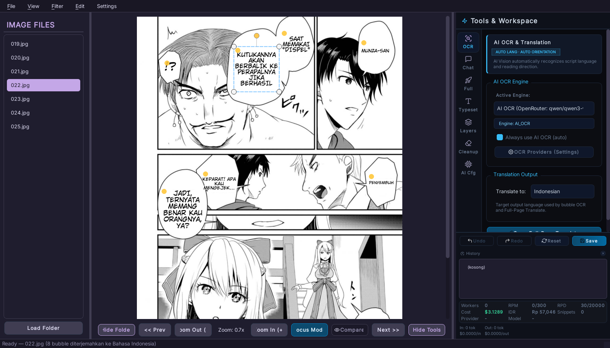
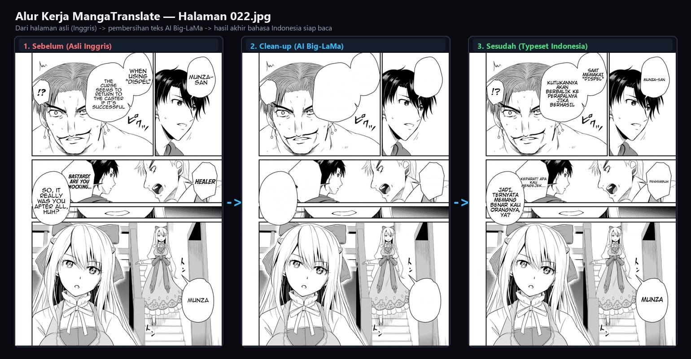
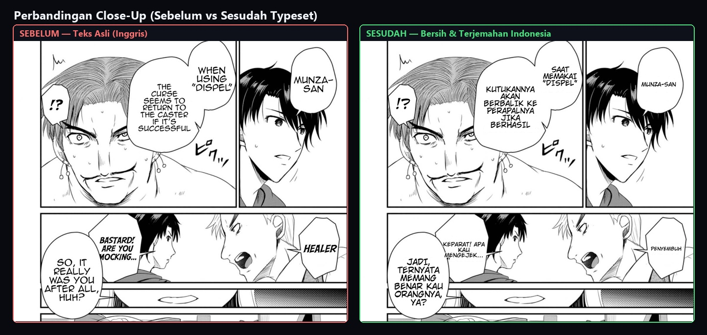
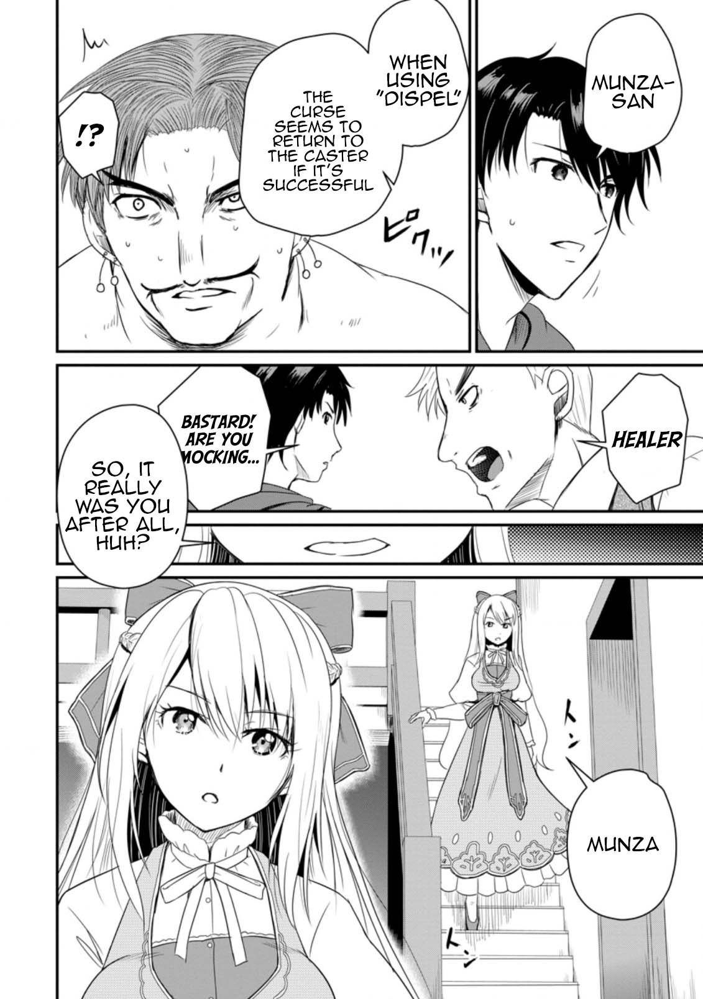
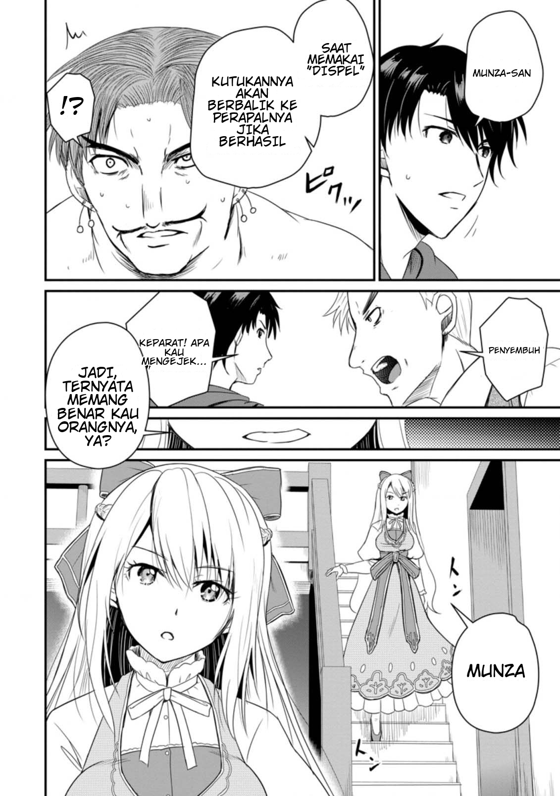
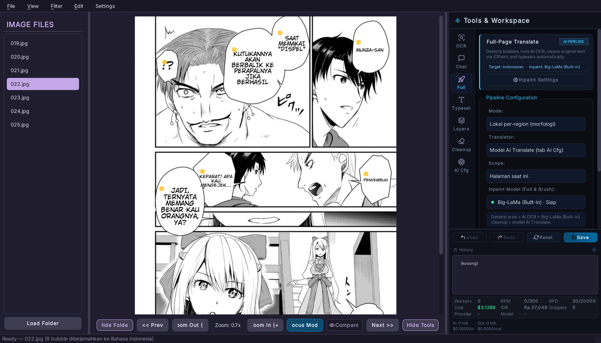
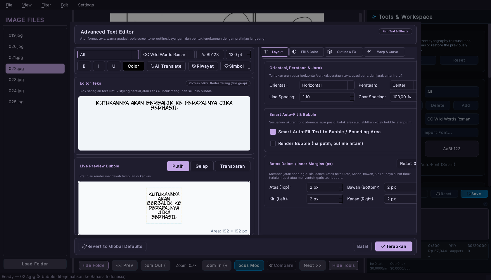
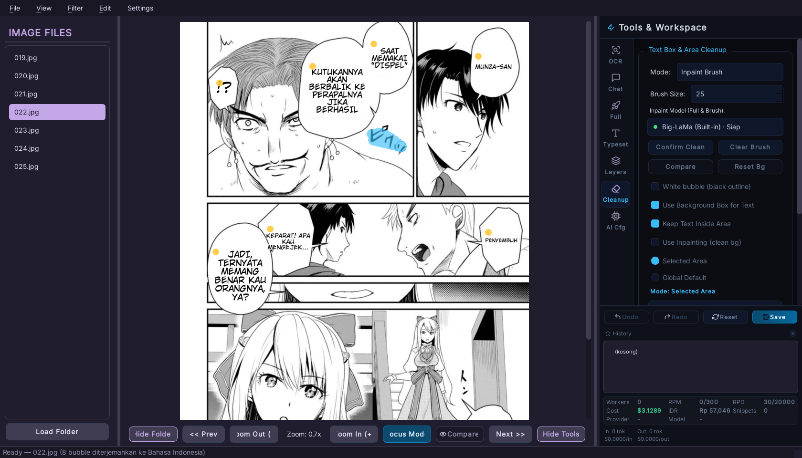

# MangaTranslate

**MangaTranslate** adalah aplikasi desktop Windows (PyQt5) untuk menerjemahkan dan menata teks (*typesetting*) halaman manga, manhwa, atau komik secara cepat dan rapi — mulai dari membaca teks asli (OCR), menghapus teks lama dengan AI (*inpainting*), menerjemahkan ke bahasa tujuan, hingga menata huruf komik siap baca.

Aplikasi ini mendukung input **gambar satuan, folder chapter, file proyek `.manga_proj`, dan dokumen PDF**, dengan seluruh proses berat berjalan di latar belakang agar tampilan aplikasi tetap responsif.

> **Versi saat ini:** `14.9.9.3`



---

## Perbandingan Hasil Nyata (Sebelum vs Clean-up vs Sesudah)

Contoh di bawah menggunakan halaman `022.jpg` dari chapter manga berbahasa Inggris yang diproses langsung di MangaTranslate memakai AI Inpainting bawaan (**Built-in Big-LaMa**) dan font komik **CC Wild Words**:

### 1. Alur 3 Tahap dalam Satu Aplikasi



1. **Sebelum (Asli Inggris)** — Halaman asli dimuat ke kanvas tanpa mengubah file sumber.
2. **Clean-up (AI Big-LaMa)** — Teks di dalam balon kata dihapus otomatis oleh AI bawaan tanpa merusak garis tepi balon maupun gambar latar.
3. **Sesudah (Typeset Indonesia)** — Teks terjemahan bahasa Indonesia ditempatkan presisi di tengah balon menggunakan fitur **Smart Auto-Fit** dan outline putih agar tetap tajam dibaca.

### 2. Perbandingan Detail (Close-Up)



### 3. Halaman Penuh: Sebelum vs Sesudah

| Sebelum (Asli — Bahasa Inggris) | Sesudah (Hasil Typeset — Bahasa Indonesia) |
| :---: | :---: |
|  |  |

<details>
<summary>Lihat daftar terjemahan balon kata pada contoh halaman 022.jpg</summary>

| Posisi Balon | Teks Asli (Inggris) | Hasil Terjemahan (Indonesia) |
| :--- | :--- | :--- |
| Panel 1 — Kanan Atas | `WHEN USING "DISPEL"` | `SAAT MEMAKAI "DISPEL"` |
| Panel 1 — Tengah | `THE CURSE SEEMS TO RETURN TO THE CASTER IF IT'S SUCCESSFUL` | `KUTUKANNYA AKAN BERBALIK KE PERAPALNYA JIKA BERHASIL` |
| Panel 1 — Kiri / Kanan | `!?` / `MUNZA-SAN` | `!?` / `MUNZA-SAN` |
| Panel 2 — Kiri Tengah | `BASTARD! ARE YOU MOCKING...` | `KEPARAT! APA KAU MENGEJEK...` |
| Panel 2 — Kiri Bawah | `SO, IT REALLY WAS YOU AFTER ALL, HUH?` | `JADI, TERNYATA MEMANG BENAR KAU ORANGNYA, YA?` |
| Panel 2 — Kanan | `HEALER` | `PENYEMBUH` |
| Panel 3 — Kanan Bawah | `MUNZA` | `MUNZA` |

</details>

---

## Panduan Cara Pakai (Untuk Pemula & Pengguna Umum)

### Langkah 1 — Buka Folder Komik atau File PDF

Buka aplikasi lalu pilih **Load Folder** di panel kiri (atau melalui menu **File -> Open Folder / Open PDF / Open Project**) untuk memuat seluruh halaman komik. Semua halaman akan tampil berurutan di panel **IMAGE FILES**, sehingga Anda bisa berpindah halaman lewat klik daftar atau tombol `<< Prev` / `Next >>`.

---

### Langkah 2 — Terjemahkan 1 Halaman Sekaligus (Tab `Full`)

Cara paling cepat untuk menerjemahkan satu halaman penuh (atau banyak halaman sekaligus) adalah lewat tab **Full** di panel kanan:



1. Pilih **Mode** deteksi balon kata (`Lokal per-region` atau model AI detektor).
2. Pilih **Translator** dan bahasa tujuan pada tab `OCR` / `AI Cfg` (misalnya `Indonesian`).
3. Pilih **Scope** (`Halaman saat ini`, `Halaman terpilih`, atau `Seluruh proyek`).
4. Pastikan **Inpaint Model (Full & Brush)** sudah bertanda hijau (`Big-LaMa (Built-in) · Siap`). Jika model belum diunduh, tombol **Unduh** muncul otomatis tepat di bawah pilihan model.
5. Klik tombol jalankan Full-Page Translate, lalu tunggu progres selesai — aplikasi akan mendeteksi balon, membaca teks, menghapus tulisan lama, menerjemahkan, dan menata teks barunya secara otomatis.

> **Tips:** Ingin memproses balon tertentu saja secara manual? Buka tab **OCR**, tekan angka **`9`** (**Click-to-Translate**) lalu cukup klik 1x di dalam balon kata yang diinginkan, atau tekan **`3`** (**Direct OCR Rect**) untuk menarik kotak di area teks mana saja.

---

### Langkah 3 — Atur Font, Warna & Posisi Teks (Tab `Typeset` & `Advanced Text Editor`)

Jika ada terjemahan yang ingin diubah kalimatnya, dipercantik gaya hurufnya, atau digeser posisinya:



- **Geser & ubah ukuran area:** Tekan angka **`1`** (**Transform / Hand**), lalu seret kotak teks atau tarik sudutnya langsung di kanvas.
- **Edit cepat di panel kanan (`Typeset`):** Ubah kelompok font manga (**Font Group**), ukuran huruf, bold/italic, warna teks, atau klik **Auto-Font (Smart)** agar teks otomatis pas di dalam balon.
- **Edit lengkap (`Advanced Text Editor`):** Klik dua kali pada area teks (atau klik ikon pensil saat mengarahkan kursor) untuk membuka editor kaya fitur dengan **Live Preview Bubble**, pengaturan jarak spasi (*line/char spacing*), margin dalam, warna gradasi, pola *screentone*, outline/shadow, efek melengkung (*Warp & Curve*), hingga sisipan simbol manga & riwayat terjemahan.

---

### Langkah 4 — Hapus Efek Suara (SFX) atau Coretan Bebas dengan `Inpaint Brush` (Tab `Cleanup`)

Untuk tulisan atau efek suara (SFX) yang berada di luar balon kata — seperti tulisan **`ピクッ`** di dekat karakter — gunakan fitur kuas AI:



1. Buka tab **Cleanup** di panel kanan (atau tekan angka **`0`**).
2. Pada **Mode**, pilih **`Inpaint Brush`** (untuk sekadar menghapus bersih) atau **`Inpaint Brush + OCR Translate`** (hapus sekaligus langsung baca & terjemahkan).
3. Atur **Brush Size** sesuai ketebalan tulisan, lalu sapukan kuas berwarna biru di atas teks/SFX pada kanvas.
4. Klik **Confirm Clean** (atau klik kanan langsung pada kanvas) — model AI aktif (`Big-LaMa`, `Manga Inpaintor`, atau `MI-GAN`) akan menghapus tulisan secara mulus mengikuti tekstur latar.
5. Gunakan tombol **Compare** kapan saja untuk mengintip halaman sebelum dihapus, atau **Reset Bg** bila ingin mengembalikan latar asli.

---

### Langkah 5 — Simpan Proyek & Ekspor Komik Jadi

- **`Ctrl + S` (Save Project):** Menyimpan seluruh progres kerja (daftar area teks, layer, undo/redo, dan hasil bersih latar belakang) ke file ringkas `.manga_proj` agar bisa dilanjutkan lagi nanti.
- **`Ctrl + Shift + S` (Save Image):** Mengekspor halaman aktif menjadi gambar bersih siap unggah dalam format `PNG`, `JPG`, atau `WEBP`.
- **Menu `File -> Export`:** Mendukung ekspor satu folder chapter langsung ke format **PDF** atau **CBZ**, serta pemrosesan banyak file melalui fitur **Batch**.

---

## Ringkasan Fitur Utama

- **AI Inpainting Terintegrasi (Tanpa Server Tambahan):** Sudah membawa mesin inpainting in-process langsung di aplikasi (**Built-in Big-LaMa** sebagai default cepat & serbaguna, **Manga Inpaintor** khusus lineart/screentone hitam-putih, dan **MI-GAN** yang ringan), lengkap dengan indikator kesiapan model (`· Siap` / `· Unduh`), fallback **OpenCV**, serta dukungan opsional **IOPaint Server**.
- **OCR Multi-Engine & Auto Orientasi:** Mendukung **AI Vision OCR** (otomatis mendeteksi bahasa Jepang/Korea/China/Inggris & arah baca), **Manga-OCR**, **Tesseract**, **EasyOCR**, **PaddleOCR**, **DocTR**, dan **RapidOCR**.
- **Penerjemah AI & Standar Fleksibel:** Terhubung dengan **Gemini**, **OpenAI**, **OpenRouter**, **9Router**, **Ollama** (lokal/offline), dan **DeepL**, lengkap dengan pilihan gaya bahasa terjemahan (*Sesuai Konteks Manga*, *Santai*, dll.).
- **Typesetting Berbasis Layer:** Mendukung pengaturan visibilitas, kunci layer (*lock*), opasitas, urutan layer, orientasi teks horizontal/vertikal/vertikal tegak (`vertical_upright`), rotasi, dan salin/tempel gaya (`Ctrl+C` / `Ctrl+V`).
- **Workspace Nyaman & Anti-Macet:** Mode Fokus (`F2`) untuk membaca/mengedit layar penuh, *Quick Compare* untuk membandingkan sebelum/sesudah, riwayat *Undo/Redo* visual, *AI Chat* terintegrasi di sidebar untuk diskusi konteks dialog, serta monitor biaya & kuota API (*Cost / RPM / RPD*).

---

## Persyaratan Sistem

- **Sistem Operasi:** Windows 10 atau Windows 11 (64-bit).
- **Python:** Python 3.9 atau lebih baru (disertai `venv` bila menjalankan dari source).
- **Koneksi Internet:** Diperlukan saat menggunakan penerjemah/OCR berbasis cloud (Gemini, OpenAI, OpenRouter, DeepL) atau saat mengunduh model AI pertama kali.
- **Opsional:** Tesseract OCR untuk pengguna mode offline Tesseract, atau GPU NVIDIA CUDA untuk akselerasi pemrosesan AI lebih cepat (tetap berjalan lancar di CPU).

---

## Instalasi & Cara Menjalankan Aplikasi

### Opsi A — Cara Termudah (Untuk Pengguna Umum)

1. Clone atau unduh repositori ini ke komputer Anda:

   ```bash
   git clone https://github.com/irazawa/MangaTranslate.git
   cd MangaTranslate
   ```

2. Klik dua kali **`MangaTranslate.exe`** (atau **`launcher.bat`**) di folder utama aplikasi.
   Pada pemakaian pertama, aplikasi akan otomatis menyiapkan virtual environment (`venv`) dan dependensi yang dibutuhkan sebelum membuka jendela utama.

### Opsi B — Menjalankan dari Terminal (`venv`)

Jika `venv` sudah tersedia di folder proyek, Anda dapat langsung menjalankan:

```powershell
venv\Scripts\python.exe main.py
```

### Pengaturan Awal API Key (Agar Terjemahan AI Jalan)

Buka menu **Settings** di bagian atas aplikasi, lalu masukkan API key layanan pilihan Anda (misalnya **OpenRouter**, **Gemini**, **OpenAI**, atau **DeepL**). Semua kunci tersimpan terenkripsi di komputer lokal Anda dan tidak dikirim ke mana pun selain ke penyedia API yang Anda pilih.

---

## Tombol Pintas (Shortcut Keyboard)

### Mode Seleksi & Kuas Kanvas

| Tombol | Mode | Kegunaan Singkat |
| :---: | :--- | :--- |
| `1` | Transform / Hand | Menggeser, memutar, dan mengubah ukuran kotak teks yang sudah ada |
| `2` | Pen Tool | Menggambar poligon area seleksi bebas titik demi titik |
| `3` | Direct OCR (Rect) | Tarik kotak di area teks untuk OCR + terjemahkan langsung |
| `4` | Direct OCR (Oval) | Tarik elips/oval di area teks untuk OCR + terjemahkan langsung |
| `5` | Manual Text (Rect) | Buat kotak teks kosong manual tanpa OCR |
| `6` | Manual Text (Pen) | Buat area teks poligon manual tanpa OCR |
| `7` | Bubble Finder (Rect) | Deteksi bentuk balon otomatis di dalam area kotak |
| `8` | Bubble Finder (Oval) | Deteksi bentuk balon otomatis di dalam area oval |
| `9` | Click-to-Translate | Cukup 1 klik di dalam balon kata untuk deteksi + terjemahkan |
| `0` | Inpaint Brush | Mode kuas untuk menghapus teks/SFX pada kanvas |

### Navigasi & Aksi Cepat

| Tombol | Aksi |
| :---: | :--- |
| `F2` | **Focus Mode** — sembunyikan semua panel samping agar kanvas penuh |
| `F3` | Tampilkan / sembunyikan panel daftar file di sebelah kiri |
| `F4` | Tampilkan / sembunyikan panel *Tools & Workspace* di sebelah kanan |
| `Ctrl + S` | Simpan file proyek (`.manga_proj`) |
| `Ctrl + O` | Buka file proyek (`.manga_proj`) |
| `Ctrl + Shift + S` | Simpan/ekspor halaman aktif menjadi gambar (`PNG` / `JPG` / `WEBP`) |
| `Ctrl + Z` / `Ctrl + Y` | Undo / Redo perubahan |
| `Ctrl + H` | Cari dan ganti teks (*Find and Replace*) lintas halaman |
| `Ctrl + C` / `Ctrl + V` | Salin dan tempel area typeset beserta gayanya |

---

## Arsitektur Singkat & Struktur Folder

Entry point aplikasi adalah `main.py`, yang menjalankan jendela utama `MangaOCRApp` (`src/ui/main_window.py`). Tampilan antarmuka menggunakan PyQt5 dengan kanvas interaktif di `src/ui/canvas.py`, editor teks kaya fitur di `src/ui/advanced_text_editor_dialog.py`, dialog pengaturan di `src/ui/dialogs.py`, serta tema visual terpadu di `src/ui/theme.py`. Operasi berat seperti OCR, terjemahan batch, penyimpanan proyek/gambar, dan AI inpainting dijalankan di `QThread` terpisah (`src/core/workers.py` & `src/core/inpaint.py`) agar GUI tidak pernah membeku.

```text
MangaTranslate/
├── main.py                     # Entry point utama aplikasi
├── launcher_app.py             # Wrapper launcher Windows (MangaTranslate.exe)
├── requirements.txt            # Daftar dependensi Python
├── settings.json               # Konfigurasi lokal pengguna (otomatis dibuat)
├── tessdata/                   # Data bahasa Tesseract OCR
├── docs/
│   └── images/                 # Gambar panduan & perbandingan README
└── src/
    ├── core/                   # Konfigurasi, cache, model AI inpaint, worker background
    ├── ui/                     # PyQt5 UI, canvas, dialog, panel, ikon SVG, teks & tema
    ├── utils/                  # Helper umum, enkripsi Fernet, geometri, pengunduh font
    ├── fonts/                  # Koleksi font manga bawaan & kustom
    └── models/                 # Model detektor & AI inpainting lokal
```

---

## File Proyek & Keamanan Data

- Proyek disimpan ke format arsip `.manga_proj` (`schema_version` 4) dengan path gambar relatif jika memungkinkan sehingga folder proyek mudah dipindahkan.
- API key dienkripsi memakai helper pada `src/utils/crypto.py` dengan kunci lokal `.secret.key`. **Jangan pernah membagikan atau meng-commit `settings.json` maupun `.secret.key`** ke repositori publik.

---

## Catatan Pengembang & Verifikasi

Gunakan virtual environment proyek untuk pengecekan kode dan pengujian antarmuka tanpa memunculkan jendela ke desktop:

```powershell
# Cek sintaks Python pada file yang diubah
venv\Scripts\python.exe -m py_compile path\to\changed_file.py

# Jalankan seluruh test suite dalam mode offscreen
$env:QT_QPA_PLATFORM="offscreen"; venv\Scripts\python.exe -m pytest tests -v
```

### Aturan Sinkronisasi Versi

Setelah perubahan kode selesai dan sebelum commit atau push, naikkan versi aplikasi pada `src/core/app_info.py` (`APP_VERSION`), lalu sinkronkan teks versi di header file, `README.md`, dan dokumentasi proyek bila relevan. Jangan ubah `schema_version` kecuali struktur format file `.manga_proj` ikut berubah.
